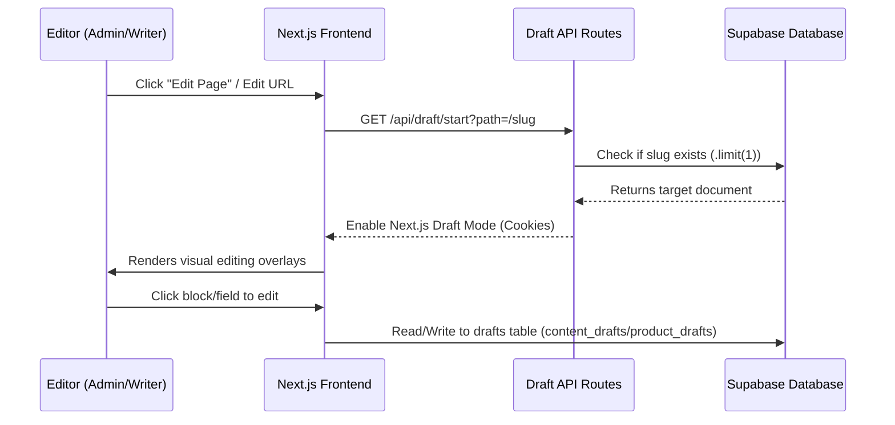

# Live Draft Mode

NextBlock features a real-time visual editing environment called **Live Draft Mode**. It allows editors to click on page elements, blocks, and product fields directly in the frontend website to edit them in-place, saving changes as non-destructive draft versions before publishing them to the live site.

This document describes the architectural design, API endpoints, database schema, component integrations, and local verification steps for Live Draft Mode.

---

## 1. Architecture Overview



Live Draft Mode consists of:
1. **Next.js Draft Mode Endpoints**: Verifies document existence and sets Next.js draft-mode headers/cookies.
2. **Visual Editing Overlays**: DOM attributes (e.g., `data-vercel-edit-info`) that identify editable documents and fields.
3. **Draft Tables**: Database tables (`content_drafts` and `product_drafts`) that store structural block snapshots and metadata.
4. **Draft Mutations**: Server actions (`loadVisualEditingBlockContent`, `saveVisualEditingBlockDraft`) to perform non-destructive updates.

---

## 2. Draft API Endpoints

NextBlock has two primary draft entry-point routes:
* `/api/draft` - Validates token/secret and redirects to the target page with draft mode active.
* `/api/draft/start` - Checks current user session authorization and document existence, then starts draft mode.

### Target Existence Verification
To support multi-language routing, NextBlock allows identical slugs to exist across different languages (e.g., `/articles` can exist in both English and French translation trees).
* **Fix**: Endpoints verify existence using `.limit(1)` rather than `.maybeSingle()`. This prevents Postgrest errors (`PGRST116: multiple rows returned`) when querying shared slugs.

---

## 3. Database Schema

Draft data is separated from live production data to ensure non-destructive previewing.

### Content Drafts (`content_drafts`)
Stores page and post drafts.
* `parent_type`: `"page" | "post"`
* `parent_id`: The page or post ID (bigint). It carries no foreign key, since it names a row of either table; `(parent_type, parent_id)` is unique, so a page or post has one draft at most.
* `meta`: JSONB object storing draft metadata (title, slug, status, meta fields).
* `blocks`: JSONB array storing all draft blocks associated with the page/post.

### Product Drafts (`product_drafts`)
Stores product drafts: one row per product. The first description-block edit (CMS → Products → Product Description Blocks, or on the storefront), the first in-page field edit, a product form autosave or a CMS import in draft mode creates it.
* `product_id`: Foreign key reference to product ID (UUID string).
* `blocks`: JSONB array storing draft description blocks (rich layout). A draft created by a description-block edit, an in-page field edit or the product form's autosave starts from the live `blocks` rows; a CMS import in draft mode stores the file's blocks (over an open draft too), an empty list when the file has no description blocks or HTML. Publish replaces the live rows with this list, an empty list included: it then deletes them all. While the visual editor is on, the storefront's `product_details` block shows this list whenever it finds a draft for the product (none for an empty list), and the live rows only without one (`ProductDetailsBlockRenderer`); the CMS edit page shows the draft's list too.
* `meta`: JSONB object in one of three shapes. `classifyProductDraftMeta` (`lib/visual-editing/product-draft-meta.ts`) tells them apart, and the shape decides what Publish writes:
  * **Overlay**: `{}` when a block edit or the in-page editor creates the draft, then `title`, `short_description` and `description_json` as the in-page editor saves them. Publish writes those fields where they differ from the live row (with `updated_at`), and no price, variant, gallery, category or sale window. An UPDATE that matches no row stops the publish before any block is written, and the draft stays: the error ends "Nothing was published; the draft is kept." (the claim, below, has already rewritten the draft's `author_id` and `updated_at`, not its contents). Opening the CMS product form saves nothing; once the form saves into the draft (its autosave, after an edit made in the form), the draft holds product values instead, with the overlay fields the form showed, and Publish writes the whole form (below).
  * **Product values**: the product form's autosave, or a CMS import in draft mode. `ProductFormValues` in major units (`price: 49`, `prices: { USD: 49 }`, variant prices likewise), always a `variants` array, never an `id`, and since 0.23.4 `form_version: 2` (stamped by `saveProductDraftMeta` and the import; it never reaches `updateProduct()` or the products row). Publish sends them through `updateProduct()` (`upsert_product_with_variants`) and takes every field the draft lacks from the live product (`completeProductDraftValues` in `app/cms/products/productFormData.ts`, the exact inverse of `updateProduct()`'s x100, zero-decimal currencies included): a partial draft never zeroes a price, empties a price map, clears the description, the canonical or the sale window, or loses the live variants' values. The product-level sale window is one unit: a draft with either bound supplies both (the missing one open), a draft with neither keeps the live pair. `status` stays the live row's, and a Freemius product's sale coupon is pushed afterwards (a push that fails is a publish warning: Freemius' checkout does not apply the sale until it syncs). Publish never deletes media: an image dropped from the gallery is only unlinked and stays in the media library with its files (one checked upsert of the listed images, deduplicated and only ids that still have a media row, then one checked unlink of the rest, both after the product RPC: a failure there stops the publish with the product row and variants already written and the rest unwritten, the gallery as it was or, when only the unlink failed, holding the listed images too, and the draft kept; publish again). The draft's `media_id` and `explicitly_removed_media_ids`, which the form never shows and any `product_drafts` writer can set, never reach `updateProduct()` (`completeProductDraftValues`), so the gallery published is the draft's `product_media`, which the edit page shows, or the live one. Until 0.23.4 a publish deleted every dropped image, and every media row `explicitly_removed_media_ids` named, that no product, post, logo or variant used, and on R2 every key those rows listed; a hidden `media_id` replaced the whole gallery, and on R2 an image that page blocks or the social image still showed lost its files. Every product-values publish re-creates the variants, whatever the edit touched: the RPC deletes the product's variant rows and inserts the draft's, so they get new ids, past order items lose their variant link (`order_items.variant_id` becomes NULL), and pending scheduled variant prices (`scheduled_price`, `scheduled_prices`, `scheduled_price_at`, which the promotions import writes) are dropped: the form never sends them (`productSchema` strips them from every save) and the RPC never writes them. A CMS import in draft mode, 0.23.4's included, stores a blank or a default for every column its file lacks (an empty gallery, no variants, no description, no categories: the full list is under "Drafts an earlier version saved"). Since 0.23.4 the import stamps the marker, so nothing checks those blanks, and Publish writes them as stored.
  * **Legacy row snapshot**: a draft that a block or in-page edit created before 0.23.4 holds the raw `products` row (an `id`, prices in cents, no `variants`). Publish treats it like an overlay. Its title and short description may be the row as it was when the draft was created, or in-page edits, and the two cannot be told apart. So they are written only while the product is unchanged since the draft was created (`products.updated_at` at or before `product_drafts.created_at`); otherwise Publish skips them and its warning names them, so a later change is not reverted. The description follows the same rule in a draft created before 2026-05-28 (deploys of master copied the description into new drafts from 2026-05-21 to 2026-05-27). In a later draft it can only be an in-page edit, because no release seeded one (create-nextblock 0.8.11, 2026-06-11, the first release with drafts, already left it out), so it is written wherever it differs.
    * No trigger maintains `products.updated_at`. The writes that change a product's title or descriptions set it: the product RPC and `updateProduct()`'s follow-up writes, Cortex's field updates, a live CMS import, the data migrations 02019, 02020 and 02032, an overlay publish, and since 0.23.4 the Freemius sync, a revision restore, Copy from language and Cortex's raw database tools (`execute_database_mutation`, `execute_database_action_plan`), which stamp every products update or upsert whatever `updated_at` the call carries. A live CMS import, a revision restore and Copy from language also delete the draft. A Freemius sync before 0.23.4 did not set it (a snapshot's old title then publishes over the synced one until the next sync rewrites it), and neither does a write through the Data API or SQL that leaves `updated_at` out, nor the YouTube embed fix `02000_catchup_gen1.sql` replays on a database that catches up through it (it rewrites `short_description` and `description_json`; the catch-up's other product fixes set `updated_at`): after such a write a snapshot's stale field can publish over it.
    * The first in-page field save into a legacy snapshot rewrites it as an overlay with no `id`: the fields Publish would write at that moment, plus the edit. The snapshot fields it keeps besides the edited one (and besides a description that is an in-page edit) are recorded in `legacy_snapshot_fields`, with the snapshot's `created_at` in `legacy_snapshot_created_at`. Publish, the storefront preview, the in-page editor and the CMS form keep applying the rule to them: written while the product is unchanged since the snapshot was taken, skipped with the warning once it changed (the edit page then names them too). Saving a recorded field in the page again makes it an in-page edit. The fields Publish would have skipped at that moment are dropped. A description-block edit leaves a legacy snapshot as it is.
* **What the preview and the in-page editor show**: the title, short description and description that Publish would write (the live value for a field it would skip). For a draft that Publish refuses with an emptied description (`findPoisonedProductDraftFields` names it), they show the live description instead, as the CMS editor does; a draft refused only for other fields shows its own. The storefront preview shows prices, variants, the gallery, stock and the sale window live until publish.
* **In-page edits into an old draft** (unmarked product values an earlier version saved): the in-page editor saves no field into one that Publish refuses (`findPoisonedProductDraftFields`), and none when it cannot read the live product to check. It answers with Publish's explanation (a CMS draft import's own, for one) and advice: open the product in the CMS editor, check the named fields, save a change (or discard the draft), then edit here. Otherwise an in-page save could erase the check's only sign (an emptied description) and let the draft's x100 prices publish. Nor does it save an edit that would make Publish refuse a draft it accepts: in such a draft an empty description over a live one reads as the earlier version's copy, so emptying it is refused, with advice to clear it in the CMS editor, whose autosave marks the draft as written by 0.23.4.
* **Who publishes**: only an ADMIN past the second factor (`requireCmsAdmin()`, the first statement of `publishProductVisualEditingDraft`, before anything is read), whatever the draft holds. Anyone else gets an error that starts with "Only an administrator can publish products." A signed-in account that is not an ADMIN and is past its second factor (or has none enrolled, or is on a remembered device) gets exactly that sentence. Without a session, or while an enrolled second factor is pending (whatever the role, ADMIN included), it continues "If you are one, sign in and complete two-factor verification, then publish again." Nothing is read or written. `product_revisions` takes only ADMIN inserts, and before 0.23.4 the product RPC refused everyone else anyway. WRITERs keep editing and discarding drafts. History is recorded through the admin's own session.
* **The Publish button**: for anyone but an ADMIN past the second factor, the CMS draft bar (`DraftStatusActions`) and the storefront toolbar (`NextblockVisualEditing`) disable Publish on a product draft and say "An administrator publishes product changes." (on the storefront, an ADMIN whose second factor is pending reads "Complete two-factor verification to publish product changes." instead, below); Discard stays, and pages and posts are unchanged. Both get the flag from `currentUserCanPublishProductDrafts()`, the `getCmsActor()` check publish opens with. The product edit page asks it; the root layout asks it only while the visual editor is on (draft mode or `NEXTBLOCK_VISUAL_EDITING_ENABLED`, loading the module through `import()`) and hands it to `DeferredVisualEditing`, adding `secondFactorPending` when the profile the layout already reads says ADMIN and the check said no (or failed). That only changes the toolbar's note; in the CMS such an ADMIN never reaches the edit page, because the CMS layout sends them to `/two-factor` first. The flags only spare a refused round trip: publish checks again on the server.
  * After a successful publish or discard, the CMS draft bar hides at once, and comes back for the next draft: a page or post's when its `hasDraft` turns off (the refresh) and on again (a later block edit), a product's on the next autosave after it hid, or when the server reports a draft again after reporting none (a description-block edit: `draftSaveCount`, from `ProductDraftFlagProvider`), since that flag never turns off before a reload. So the edit a skipped-title or duplicated-blocks warning asks for gets its own Publish. A publish that went live with a warning (fields a pre-0.23.4 draft could not publish, description blocks that may show twice, history not recorded, a Freemius sale coupon not pushed), or with an error that starts "Published, but" (the edits are live and only the draft row stayed, so it counts as a success with that warning; a failed draft delete carries the publish's other warnings after it, the paths were revalidated before the delete for pages, posts and products alike, and the bar stays, since the draft row still exists), keeps the warning on screen in a toast with "Reload page" (closes it and reloads) and "Dismiss" (closes it) buttons; nothing reloads before that, and a click on the toast never closes an open block editor (`isToastInteraction`). A publish without a warning, and a discard, reload the page 800 ms later, because the edit page's draft flag only ever latches on (`ProductDraftFlagProvider`, below). A product skips `router.refresh()`: the action's own `revalidatePath` (publish and discard both revalidate the edit page) already makes Next re-render the edit page in the action's response, which resets the product form to the published (or live) values, and `ProductForm` remounts its variations editor on every reset after the first, so the editor never hands back the variants it held before (the old ids after a publish, the discarded values after a discard) for the autosave to save. Pages and posts refresh at once (a page or post discard revalidates nothing), then reload too unless a warning came back. A publish that answers `NO_PRODUCT_DRAFT_ERROR` or `NO_CONTENT_DRAFT_ERROR` (the draft was published or discarded in another tab) is not shown as a failure: the bar says there was no draft left to publish, hides and reloads like a publish without a warning.
* **The visibility control** (the CMS top bar: Publish…, Schedule…, Unpublish, Archive): only an ADMIN can change a product's visibility (`products_update_policy` is `is_admin()`, so for anyone else `setContentVisibility`'s UPDATE matches no row and every action failed with a database error). The product edit page hands the control the same flag, and for anyone else those actions are disabled with the same note; Copy public URL stays, and pages and posts are unchanged.
  * Publish… offers "Publish your unpublished edits at the same time", ticked, whenever the control knows of a draft: the server's `hasDraft`, or on the product edit page the flag the editor shell latches after an autosave (`ProductDraftFlagProvider`, which the page wraps around both). The form's autosave creates a draft without revalidating the page, so with the server's flag alone a draft autosaved since the page loaded was not offered, and Publish… made the older live version public while the draft bar showed the draft. The latch can outlive the draft when a publish or discard in another tab deletes it (a product revision restore deletes the draft too, so `RevisionHistoryButton` reloads a product's page 800 ms after a restore, which turns the latch off): a draft publish that answers "No draft exists for this product." (`NO_PRODUCT_DRAFT_ERROR`, or `NO_CONTENT_DRAFT_ERROR` for a page or post) counts as no edits to publish, the visibility change goes on alone, and a product then reloads 800 ms later, which turns the latch off.
  * With the box ticked, the dialog publishes the draft first and changes the visibility after it, for pages, posts and products; without a draft, or with the box unticked, it writes only the visibility. If the draft publish returns an error other than that no-draft answer, the dialog says "The visibility was not changed, because publishing the edits failed: …", tells the editor to untick the box to publish without them, and writes nothing else, so the older live version never goes public in its place; a draft publish that throws (a network failure) shows only its message and writes nothing else either. An error that starts "Published, but" (the edits went live, but the draft row was not removed) counts as a success with that warning, and the visibility change goes ahead.
  * Draft publish never changes `status` or `published_at`, and a product's publish runs before the visibility UPDATE (which sets `products.updated_at`), so that UPDATE never counts as a later change that skips a pre-0.23.4 snapshot's fields.
  * If the edits went live and the visibility change then failed, the dialog says so and a retry changes only the visibility. A warning from the draft publish (history not recorded, fields a pre-0.23.4 draft could not publish, description blocks that may show twice, a draft row left behind) stays in the dialog, which stays open once the visibility changed, until the editor closes it; reopening Publish… starts without it. None of the four dialogs can be dismissed while its write runs: Escape, a click outside and the X are ignored, and Cancel is disabled. When the publish dialog closes after a product draft went live (at once on success, or when the editor closes it after a warning or a failed visibility change), or after a visibility change that went ahead because a product's draft was already gone (above), the page reloads 800 ms later, as from the draft bar; after any other change the control refreshes it.
* **Publishing the blocks**: no transaction wraps a publish (supabase-js sends each statement as its own request).
  * Publish reads the ids of the product's live `blocks` rows (1000 at a time) and the content History records as "before", claims the draft, writes the product row (product values or the overlay fields), inserts the draft's rows, then deletes only the ids it read and counts the rows that delete removed. `blocks` has no unique constraint on `"order"`, so both sets coexist for that moment.
  * The claim is an UPDATE of the draft's `author_id` that matches only the row as Publish read it (its `id` and `updated_at`); `on_product_drafts_update` (02003) moves `updated_at` on every update. Of two publishes that read the same draft, the one that claims it second gets no row back and stops before writing anything: "Another publish of this draft started first, or the draft changed since it was read: nothing was published." So does a publish whose draft something saved into between its read and its claim (an in-page save, a block edit, a form autosave from another tab, a Cortex edit that syncs the draft); that change stays in the draft. A known limit in 0.23.4: a save from another tab or user that lands after the claim reports success but is deleted with the draft when the publish finishes; inside one tab, Next runs the autosave and the publish action one after the other. A claim that fails ends "Nothing was published; the draft is kept."
  * A failed insert deletes nothing. A failed delete is treated as one that removed nothing, so the rows just inserted are taken back out (best effort; when they cannot be identified or removed, the error says the page shows both).
  * A delete that removed fewer rows than it read means another writer removed some of them while the publish ran: another publish of the same draft (the claim stops only a publish that read the draft before another one claimed it), a revision restore, Copy from language, a live CMS import or a direct database write (Cortex's raw database tools included). In-page and CMS block edits write only the draft, and Cortex's block tools only update or insert rows, so none of them removes live product blocks. Publish then keeps the rows it inserted, since taking them back out could leave none, and succeeds with `PRODUCT_DESCRIPTION_BLOCKS_CHANGED_WARNING`: "Published, but some of the description blocks this publish replaced had already been removed while it ran (…). Check the product's description blocks: the page may show some twice."
  * Known limit in 0.23.4: two publishes of the same draft (two tabs or two admins) can still leave the description blocks twice, when the second reads the draft after the first one's claim and reads the live block ids before the first one's insert. One of the two returns that warning; a product with no live description blocks has no ids to count, so then neither warns. The planned fix is an RPC that swaps the blocks under a row lock.
  * An error in the block step says what is already live (the draft's product values, or the overlay fields it names) and that the draft is kept, and asks to publish again; the storefront is revalidated when the product row was written. A partial publish records no revision.
* **Drafts an earlier version saved**: before 0.23.4 the edit page showed a legacy row snapshot as form values, so the first autosave over one stored its cents as dollars, the stock of the day the snapshot was taken, and no variants, gallery or description (a snapshot a deploy of master took from 2026-05-21 to 2026-05-27 kept the description), with no `form_version`; variants rebuilt on that page came from the inflated price, with no stock. A CMS import in draft mode also wrote unmarked product values, every column the file lacked as a blank or a default: an empty gallery, no variants and a null description when it had no media, variant or description columns. Publish and the edit page check an unmarked product-values draft against the live product (`findPoisonedProductDraftFields` in `app/cms/products/productFormData.ts`); a marked draft, an overlay or a legacy snapshot is never checked.
  * An autosave (the form always stores a `variation_attributes` array; the import never did) counts as saved over a snapshot when an amount reads as a live amount in cents: equal to it, or at least 20 times the live amount in major units (the price and sale price, each price-map entry in a currency that has cents, and each variant's amounts against its live variant, matched by combination key then id). A variant with no live row counts when an amount equals the product's live amount in cents, or 100 times the draft's own amount in the same field and currency (`holdsDraftAmountInCents`: the old page built such a variant from the x100 base, which the editor may have corrected since). It also counts when its price is one of the product's Freemius plan prices in cents (`freemius_plans` → `freemius_pricing`: every pricing row's monthly, annual and lifetime price; the sync sets the price from one of them), and when it has no variants for a physical product that has some, an empty gallery over a live one, or an empty description over live content. Currencies without cents (JPY, KRW, …) are left out of the amount rules, and so are the price and sale price (the product's and each variant's) and the plan prices when the live product shows its default currency may be one of them: `sync_currency_price_maps` keeps `prices[default]` equal to `price`, so an entry without cents equal to the product's or a variant's price or sale price may be the default. Every group whose values differ from live is then flagged: prices and sale prices, always together (a sale price repaired beside a x100 regular price made a 99% Freemius coupon); variants with their attributes (physical products), when the rows or their amounts, stock, SKU, UPC, image or sale window differ; a physical product's stock, when the draft or the live product has no variants (the RPC writes the top-level stock only then); the gallery, when it leaves out a live image (publishing it would unlink an image the old editor never showed); the description, when it is empty over live content.
  * A draft import the old editor never autosaved (no `variation_attributes`) gets no amount rule: only an empty gallery over a live one, no variants for a physical product that has some, and a description that is null (left out) or an empty document over live content are flagged, so its prices stay the file's, and so does its stock unless its variants are shown live. Its other blanks and defaults are not checked and publish as stored: the short description, SEO title and description, UPC, sale price, currency price and sale-price maps (only the default currency's price stays), Freemius ids and categories (which the product's translations lose too), no trial, taxable, and, without product type and payment provider columns, a physical product sold through Stripe. Its description blocks are the file's: where the file gave none, publishing deletes the live ones. An import the old editor autosaved carries `variation_attributes` and the import's empty groups, so it is read as an autosave over a snapshot, the file's prices and stock included.
  * Publish refuses a flagged draft, naming the groups. The edit page shows the live values for them, the live stock beside repaired variants, and, for an autosave over a snapshot, a digital product's live stock without naming it (its form hides the stock; a draft import keeps the file's stock), with a note (`getProductDraftEditNotices`) that names the groups and ends "then publish (or ask an administrator to)". For an autosave over a snapshot the note opens with the 100x explanation and says the draft's other fields (title, slug, descriptions, SEO fields, categories, SKU and UPC, Freemius and trial settings) are a copy from when it was saved; for a draft import it opens with what the import did (an empty gallery, no variants and no description when the file had no such columns), and so does publish's refusal (`buildPoisonedProductDraftPublishError` given the draft's `meta`). The editor's next change autosaves the repaired values with the marker.
  * Limits: the amounts reveal a snapshot only while the live amount is above zero and at most five times what it was when the snapshot was taken, and a variant with no live row reveals one only while the product's live price is unchanged or the draft's own price is the snapshot's in dollars. The plan prices reveal it whatever the price became, unless they changed too or the plan price is above 5000 (the sync stores such a price as cents). An unmarked autosave is flagged the same way when an amount is 20 times the live one for another reason (a price an editor raised 20-fold or more, a live price or sale price that fell to a twentieth or less since), when it adds a variant priced at the product's live amount in cents or at 100 times the draft's price, or when its variants, gallery or description were emptied on purpose; every group that differs then shows live, so the editor enters that draft's changes again. So is a draft import the old editor autosaved (above).
* The edit page lays product values over the live form data, so a key the draft lacks keeps its live value, except the product-level sale window, which is one unit there as at publish: when the draft carries either bound, both come from the draft (the missing one empty), otherwise both are live. A draft variant without a combination key, options or label (a CMS draft import's: its attribute terms only) gets them from the live variant with the same terms (or, naming no terms, the same id, whose terms it takes too), else from the global attributes the edit page passes (`globalAttributes`) or the live variants' options; its prices and stock stay the draft's, and a draft with variants and no `variation_attributes` gets them from its variants. An overlay or a legacy snapshot shows as the live data plus the overlay fields publish would write (`mergeProductDraftMetaIntoFormInitialData`, `planProductDraftOverlayPublish`), with a note naming those publish would leave live: a legacy snapshot's, or the snapshot fields an overlay rewritten from one recorded, once the product changed after the snapshot was taken.

### The product editor's autosave (CMS → Products → edit)
The product form (`ProductForm` in `libs/ecommerce`) autosaves 400 ms after the last change. `updateProductAction` replaces the draft's whole `meta` with the form's values (major units, `form_version: 2`) and, when the product has no draft, creates one whose blocks are copied from the live rows. It never writes the live product.
* **What saves**: an edit made in the form, such as the title or a base price; a variant's price or sale price (in the default currency or in one priced by hand), stock, SKU, UPC, sale window (either bound) or image; or a toggled attribute term. An edit undone after its autosave is saved again.
* **A refused save is shown**: `productSchema` validates every autosave first. A refused one sends nothing, and the status line at the top of the form reads "Error saving settings:" with the first refused field (a variant by its number and its label or SKU, then the key) until a save goes through or the page renders the form again (the reset clears it). A variant SKU cleared by hand, a sale price above the price, or a variant whose terms this store does not have and that has no options (a CMS draft import from another install, refused with zod's default "Too small: expected array to have >=1 items") is refused this way. A draft variant that kept its options when its term was deleted afterwards is not: it saves, and that draft's publish then fails on the `variant_attribute_mapping` foreign key until a term toggle rebuilds the variants.
* **What does not save**: opening the editor, closing and reopening its variations panel, or the page rendering the form again with new data (after a publish, a discard or a refresh). The variations editor starts from the form's current terms and variants, a set that is not every combination of its terms included, and does not regenerate on open, so opening or reopening it emits what the form holds. `handleVariationChange` also ignores an emission whose selected terms and variants equal the form's on what a save writes (each variant's SKU, UPC, prices, sale prices, sale window, stock, image and terms, variants matched by `combination_key`; ids, labels and option names are left out). Reopening the panel keeps the variant edits made before, and a reset to new initial data remounts the editor, so the variants it held before the reset (a discarded draft's, or the ones from before a publish) are never saved back. The amounts it shows for store-managed currencies are display only: the form strips those entries from every price map.
* **An edit made just before the form renders again is lost**: an edit made less than 400 ms before the page renders the form again (a description-block save refreshes the page) is never saved, a variant's included: the reset cancels the pending autosave and puts the new data in the form.
* **Regeneration**: in the form, the editor rebuilds the variant list only when the selected terms change (a toggle), compared by value: never on open, and never on a change to the product's SKU, prices or sale. (A change to the store's currencies would rebuild it too, but `ProductForm` remounts the editor on the reset that brings one, so that cannot be seen in the form.) A toggle builds every combination of the selected terms, so on a set that is not every combination it also creates the missing ones; deselecting the last term empties the list. An existing variant keeps its own values, a missing sale price included (its options and label are rebuilt from its terms, and an empty SKU gets the product's SKU plus the term slugs). A new combination takes the product's current SKU plus the term slugs, the product's prices and sale prices as they are, the product's sale window only when it takes a sale amount, and stock 0.
* **Repairs when the form opens**: as it builds its initial values, the form repairs three things in the stored variants, with no notice, so opening still saves nothing; the first edit's autosave saves the repair, and the publish after it writes it. A variant left with no terms (its terms deleted in Attribute Management, which deletes their variant mappings) is left out, since no shopper can select it; when every variant lost its terms (the attribute was deleted), the first edit saves `variants: []`, and a publish then deletes the product's variant rows. Of variants an attribute deletion left with the same terms (Red/S and Red/M once Size was deleted), only the first is kept: the storefront's `findMatchingVariant` only ever sells the first, and the editor's rows, keyed by their terms, wrote an edit of one into all of them. 0.23.3 dropped both kinds too, with an autosave on open. An empty variant SKU gets the product's SKU plus the term slugs, and missing options, a missing label or a missing key are rebuilt from the terms and the attribute list. Any other variant `productSchema` refuses (a stored sale price above its price, terms this store lacks with no options) is kept, and every autosave is refused, with the error on the status line, until it is fixed, a term toggle rebuilds the list or the draft is discarded.
* Before 0.23.4 the editor regenerated on open, so opening a product with variants autosaved a draft, and a set that was not every combination gained the missing ones at the product's price with stock 0, as it also did on a product SKU edit. Each regeneration also gave a variant without a sale price the product's, and a new combination the product's sale price without its window (published, either was on sale at once and for good), and rounded a new combination's amounts to whole units ($49.99 became $50.00).
* Tests: `ProductForm.variations-autosave.test.tsx` and `VariationsEditor.test.tsx` in `libs/ecommerce/src/lib/pages/cms/products/components/`, and `libs/ecommerce/src/lib/variation-utils.test.ts`.

---

## 4. Visual Editing Integration

Frontend components use the `visualEditing` context to render hover overlays.

### Top-Level & Nested Blocks
Top-level blocks are rendered using `BlockRenderer.tsx`. For each block, `buildVisualEditAttributes()` generates:
* `data-vercel-edit-info`: Encodes document type, ID, slug, language, and block target (index/ID).
* `data-vercel-edit-target`: Target parameters for nested block structures.
* `data-nextblock-visual-edit`: UI identifier (e.g., `top-level:section`).

### Product-Level Visual Editing
Products support two kinds of visual editing:
1. **Field-Level Editing**: Modifying plain-text fields like `title` and `short_description`. Handled in `ProductDetailsLayout.tsx`.
2. **Block-Level Description**: Editing block layouts within the product detail description. Handled via `ProductDetailsBlockRenderer.tsx`.

> [!IMPORTANT]
> **Click Bubbling Prevention**: When block-level descriptions are rendered, the parent wrapper disables the outer `description_json` field editor attributes. This ensures clicks on individual description blocks edit the blocks themselves, avoiding `Invalid product field editor` conflicts.

---

## 5. Cortex AI Integration

The Cortex AI global agent's `rewrite_page_draft` tool writes into `content_drafts` rather than the live `blocks` table, so an AI-generated whole-page rewrite (e.g. "rewrite my home page with 5 sections") lands as an unpublished draft. It seeds the draft `meta` from the current published item and carries `base_version` from the item's version. The user then previews via `/api/draft/start?path=/<slug>` and publishes with the normal `publishVisualEditingDraft` flow, which applies the blocks live and auto-creates a revision snapshot. See [08-NEXTBLOCK-CORTEX-AI-ARCHITECTURE.md](./08-NEXTBLOCK-CORTEX-AI-ARCHITECTURE.md#external-url-ingestion-and-live-draft-page-rewrites).

Product edits go the other way: Cortex writes them to the live product. Its block tools and `set_content_images` then keep the product's open draft in step, so that publishing the draft does not undo them (`patchOpenProductDraft` in `libs/cortex/src/lib/ai-global-agent-tools.ts`); its field updates and `manage_product_variants` do not (below). `update_content_block`, `insert_content_block` and `update_section_column_block` write the change into the draft's `blocks`. `set_content_images` writes the new gallery into the draft's `meta.product_media` when the meta holds that list (the product form's values carry one; an overlay and a pre-0.23.4 row snapshot have none and are left as they are). Before it asks for confirmation, imports or writes anything, it refuses a product whose open draft it would rewrite that way while the draft holds product values without the 0.23.4 marker (the `form_version` key every product-values draft NextBlock saves since 0.23.4 carries): the old edit page autosaved some of those over a copy of the products row, publish refuses one whose values show the old editor's damage (`findPoisonedProductDraftFields`), and an empty gallery can be the only sign, which rewriting the gallery would erase. Its error asks to open the product in the CMS editor first, then save a change there or discard the draft. Such a draft without a gallery list is left as it is and the call goes ahead, and the block tools still patch such a draft's `blocks`, since they leave its meta alone. Cortex's field updates (`update_current_cms_fields`, `update_cms_item_field`) write only the live product row (with `updated_at`), and `manage_product_variants` writes the live variants (and the stock total); neither touches an open draft, so publishing a draft that stages its own value (an in-page edit in an overlay, or product values, which always carry their own variants) writes the draft's value back over theirs.

---

## 6. Local Verification

To test Live Draft Mode locally:

1. **Verify Session Authorization**:
   Make sure you are signed in as an `ADMIN` or `WRITER` in the CMS.
2. **Enter Draft Mode**:
   Visit the start draft endpoint for any page, post, or product path (port 4200 is the monorepo's `npx nx serve nextblock`; a standalone project's `npm run dev` serves port 3000):
   ```http
   GET http://localhost:4200/api/draft/start?path=/product/my-product-slug
   ```
3. **Inspect Overlays**:
   Hover over the page sections. Hover frames and edit buttons should appear.
4. **Run Automated Tests**:
   Verify draft routing rules using the test suite:
   ```powershell
   npx vitest run apps/nextblock/lib/visual-editing/draft-route.test.ts
   ```
