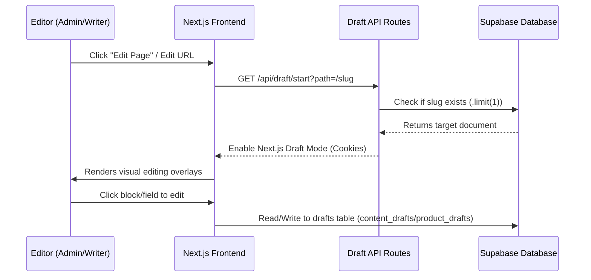

# Live Draft Mode

NextBlock features a real-time visual editing environment called **Live Draft Mode**. It allows editors to click on page elements, blocks, and product fields directly in the frontend website to edit them in-place, saving changes as non-destructive draft versions before publishing them to the live site.

This document describes the architectural design, API endpoints, database schema, component integrations, and local verification steps for Live Draft Mode.

---

## 1. Architecture Overview



Live Draft Mode consists of:
1. **Next.js Draft Mode Endpoints**: Verifies document existence and sets Next.js draft-mode headers/cookies.
2. **Visual Editing Overlays**: DOM attributes (e.g., `data-vercel-edit-info`) that identify editable documents and fields.
3. **Draft Tables**: Database tables (`content_drafts` and `product_drafts`) that store structural block snapshots and metadata.
4. **Draft Mutations**: Server actions (`loadVisualEditingBlockContent`, `saveVisualEditingBlockDraft`) to perform non-destructive updates.

---

## 2. Draft API Endpoints

NextBlock has two primary draft entry-point routes:
* `/api/draft` - Validates token/secret and redirects to the target page with draft mode active.
* `/api/draft/start` - Checks current user session authorization and document existence, then starts draft mode.

### Target Existence Verification
To support multi-language routing, NextBlock allows identical slugs to exist across different languages (e.g., `/articles` can exist in both English and French translation trees).
* **Fix**: Endpoints verify existence using `.limit(1)` rather than `.maybeSingle()`. This prevents Postgrest errors (`PGRST116: multiple rows returned`) when querying shared slugs.

---

## 3. Database Schema

Draft data is separated from live production data to ensure non-destructive previewing.

### Content Drafts (`content_drafts`)
Stores page and post drafts.
* `parent_type`: `"page" | "post"`
* `parent_id`: The page or post ID (bigint). It carries no foreign key, since it names a row of either table; `(parent_type, parent_id)` is unique, so a page or post has one draft at most.
* `meta`: JSONB object storing draft metadata (title, slug, status, meta fields).
* `blocks`: JSONB array storing all draft blocks associated with the page/post.

### Product Drafts (`product_drafts`)
Stores product drafts: one row per product. The first description-block edit (CMS → Products → Product Description Blocks, or on the storefront), the first in-page field edit, a product form autosave or a CMS import in draft mode creates it.
* `product_id`: Foreign key reference to product ID (UUID string).
* `blocks`: JSONB array storing draft description blocks (rich layout). A draft created by a description-block edit, an in-page field edit or the product form's autosave starts from the live `blocks` rows; a CMS import in draft mode stores the file's blocks (over an open draft too), an empty list when the file has no description blocks or HTML. Publish replaces the live rows with this list, an empty list included: it then deletes them all. While the visual editor is on, the storefront's `product_details` block shows this list whenever it finds a draft for the product (none for an empty list), and the live rows only without one (`ProductDetailsBlockRenderer`); the CMS edit page shows the draft's list too.
* `meta`: JSONB object in one of three shapes. `classifyProductDraftMeta` (`lib/visual-editing/product-draft-meta.ts`) tells them apart, and the shape decides what Publish writes:
  * **Overlay**: `{}` when a block edit or the in-page editor creates the draft, then `title`, `short_description` and `description_json` as the in-page editor saves them. Publish writes those fields where they differ from the live row (with `updated_at`), and no price, variant, gallery, category or sale window: the server action sends `publish_product_draft` (below) those fields alone, and the function reads no other key of them. Opening the CMS product form saves nothing; once the form saves into the draft (its autosave, after an edit made in the form), the draft holds product values instead, with the overlay fields the form showed, and Publish writes the whole form (below).
  * **Product values**: the product form's autosave, or a CMS import in draft mode. `ProductFormValues` in major units (`price: 49`, `prices: { USD: 49 }`, variant prices likewise), always a `variants` array, never an `id`, and since 0.23.4 `form_version: 2` (stamped by `saveProductDraftMeta` and the import; it never reaches the function or the products row). Publish takes every field the draft lacks from the live product (`completeProductDraftValues` in `app/cms/products/productFormData.ts`, the exact inverse of the x100 below, zero-decimal currencies included): a partial draft never zeroes a price, empties a price map, clears the description, the canonical or the sale window, or loses the live variants' values. A list field holding something that is not a list (variants, variation attributes, gallery, categories: only a hand-written draft holds one) counts as missing: the edit page shows the live value (variation attributes beside the draft's own variants come from those variants) and publish keeps it (`PRODUCT_VALUE_LIST_KEYS`). Until 2026-11-18 a variant list other than null that was not a list made `ProductForm` throw on mount, and the publish read false, 0 or an empty string as no variants, which deleted every live variant (any other such value made the publish builder throw); variation attributes that were not a list blocked every autosave (a string beside live variants made the variations editor throw). Of a draft's own variation attributes, the edit page and `ProductForm` keep only entries that are an object with a text `attribute_id`, each with its text term ids (none for `term_ids` that are not a list). A draft variant's own options count only when every one is readable (`isReadableVariantOption`: an object, not a list, with a text attribute id, attribute name, term id and term value, and a text term slug when it has one); otherwise the edit page and `ProductForm` take them from the variant's terms, as for a CMS import's variant without options, and keep its own readable ones only when nothing names its terms (`buildVariantSku`, which fills an empty SKU from them, reads only text). Until 2026-11-18 a null variation attribute entry, term ids that were an object or a number, a null option, and, beside an empty SKU, an option on a term the store no longer has whose term slug was set but not text (an object, a list, a non-zero number, true) or that had no slug (or a false or 0 one) and a term value that was not text (or a product SKU that was not text) made `ProductForm` throw when it mounted in the browser (the edit page's client shell renders the form only after mount, and /cms has no error boundary, so the page was lost for every reader); every other unreadable option blocked every autosave, and `{}` opened the variations editor with none of the variant's terms selected. The product-level sale window is one unit: a draft with either bound supplies both (the missing one open), a draft with neither keeps the live pair. It then sends `publish_product_draft` (below) the values as `buildProductDraftPublishValues` (`libs/ecommerce` `product-actions.ts`) builds them: `updateProduct()`'s RPC payload in minor units (every amount x100, each variant with its attribute terms and the draft's copy of its id) without `status`, `metadata` or the provider (the function derives it from the product type), plus the SEO fields, the gallery's media ids, the category ids (null when the values carry none: the gallery or the categories then stay as they are) and the stock the edit page loaded (`stock_baseline`, below). The function writes what `updateProduct()` wrote, in its order: the product row, the variants, the gallery, taxability and the SEO fields (blank becomes NULL), the sale price and window across the products sharing the SKU (its translations) and each variant's across the variants sharing its SKU, the shared inventory of each SKU whose stock the editor changed (below; through the admin's session: `inventory_items` has ADMIN write policies), and the categories across the translation group. Visibility belongs to the row: `status` is never written, and neither is `products.metadata`. A Freemius product's sale coupon is pushed after the publish commits (a push that fails is a publish warning: Freemius' checkout does not apply the sale until it syncs).
    * **Variants keep their rows.** Each draft variant takes the live variant with the same set of attribute terms (the draft's copy of the variant id breaks a tie between live variants with the same terms), which is updated in place: same id, so past order items keep their `variant_id` link and a shopper's cart line from before the publish still checks out, and its pending scheduled prices (`scheduled_price`, `scheduled_prices`, `scheduled_price_at`, which the promotions import writes and the form never sends: `productSchema` strips them) stay pending. Only a live variant whose term set the draft no longer has is deleted (its order items keep the line and lose the link: `order_items.variant_id` is `ON DELETE SET NULL`), and only a draft variant with a new term set is inserted. Two kept variants may swap SKUs. Until migration 02043 every product-values publish deleted and re-created every variant, whatever the edit touched: new ids, every link and pending price lost, and a cart line added before the publish refused at checkout as unavailable.
    * **Publish never deletes media**: an image dropped from the gallery is only unlinked and stays in the media library with its files (one upsert of the listed images, deduplicated and only ids that still have a media row, then one unlink of the rest, in the publish's transaction). A variant image or a category that no longer exists is left out instead of failing the publish. The draft's `media_id` and `explicitly_removed_media_ids`, which the form never shows and any `product_drafts` writer can set, never reach the function (`completeProductDraftValues` drops both, and `buildProductDraftPublishValues` has no field for either), so the gallery published is the draft's `product_media` or the live one. A `product_media` that is not a list (null, false, 0, an empty string, an object, a string: only a hand-written draft holds one) publishes no gallery (`gallery_media_ids` null), so the live one stays, and the edit page shows the live gallery for it; until 2026-11-18 it showed none for null, false, 0 or an empty string (the next autosave saved `[]` and the publish after it unlinked every image), and an object, a string, a non-zero number or true made `ProductForm` throw, which took the edit page down. The edit page reads that list with `normalizeProductGallery` (`libs/ecommerce/src/lib/product-gallery.ts`) and the function reads `gallery_media_ids` by the same rules in SQL: its order, each id lowercased and once, uuids only (neither reading trims spaces round an id or takes braces: `gallery-parity.test.tsx` pins both cases to publish's rule), then only ids that still have a media row; an entry's own `sort_order` or embedded `media` object counts for nothing. The edit page draws a draft's tiles from those media rows in that order (`resolveProductDraftGalleryForEdit` in `app/cms/products/productFormData.ts`), fails rather than show a gallery whose rows it could not read, and names the entries publish leaves out (an image no longer in the media library, an entry that is not a media id, a repeat) in a note above the form. The form's autosave stores the list as bare `{ media_id }` entries (`toProductGalleryDraftEntries` in `saveProductDraftMeta`), and the form saves its gallery in the order its gallery manager shows it (`orderProductGalleryEntries`). Until the 0.23.4 follow-up the page drew a draft's tiles from an entry's embedded `media` whenever its media query failed (one non-uuid id made it fail) or missed an id (another case, a deleted image), and in the entry's own `sort_order`: a WRITER-written draft (`product_drafts` RLS checks the role only) could show the ADMIN the live gallery while publish wrote another order or another main image. And the form saved the live gallery in the order its rows arrived (Postgres promises none for an embedded select), so an edit to any other field could change the main image. Until 0.23.4 a publish deleted every dropped image, and every media row `explicitly_removed_media_ids` named, that no product, post, logo or variant used, and on R2 every key those rows listed; a hidden `media_id` replaced the whole gallery, and on R2 an image that page blocks or the social image still showed lost its files.
    * **Stock: only what the editor changed** (migration 02044). The values carry `stock_baseline`, the stock the edit page loaded per SKU (`{ "<sku>": quantity }`: each variant's, or the product's without variants; `buildProductStockBaseline` in `productFormData.ts`), which `ProductForm` carries unseen and the autosave stores. The function compares each SKU's quantity in the draft with its baseline and with the SKU's current quantity (its inventory row, or without one the live stock; the publish gives such a SKU an inventory row). Equal to the baseline (the editor left it alone): `inventory_items` stays as it is, and the variant and product rows take the current quantity. Equal to the current quantity: left alone too, because the change is already live. A draft started again after its publish (an autosave that ran after the commit, or another tab, found the draft gone and saved the form's values into a new one) still carries the baseline from before it: loaded 5, typed 10 and published, the same values would otherwise publish 15. A baseline written by hand (any `product_drafts` writer, a WRITER over PostgREST included) does nothing beside the live quantity either. But a quantity that sales or another stock update (the Inventory screen, an import, a translation's publish) reached meanwhile looks the same and stays too (loaded 10, 9 typed for a damaged unit, one sold meanwhile: 9 stays, where 8 was meant), so the answer names every SKU this rule decides (below). Any other quantity: the change (the draft's quantity minus the loaded one) is applied to the current quantity, never below 0, so a sale made while the page was open keeps its deduction and the edit still lands (loaded 5, typed 15, one sold meanwhile: 14; with nothing in between, exactly the quantity typed). A SKU the baseline lacks (a variant added, a SKU renamed) is written as the draft holds it, and so is one the live product does not stock (another product's SKU, one another publish removed since, a product whose stock is NULL): publish sends no baseline entry for it (`resolvePublishedStockBaseline`). The function reads a SKU's current stock from `inventory_items`, shared by SKU across products, so until 2026-11-18 a hand-written entry for another product's SKU was applied to that product's row (the edit page showed 51; publish wrote 0 there). A product's stock beside variants is their total, held at 2147483647 (above it the total raised 22003), and so is the total the inventory trigger writes (`sync_inventory_cache_for_sku`, which 02044 replaces with that one change; since 02046 the trigger runs once per statement, through `private.sync_inventory_caches`: Limits below). Until 02044 the publish wrote every quantity the draft held, the stock from the page load, so a sale between the page load and Publish was written back over (as `updateProduct()` and the shared-inventory sync did through 0.23.5), and so was a change made meanwhile on the Inventory screen, by an import or by the publish of a translation sharing the SKU.
      * **Which publish a baseline was loaded against** (migration 02047). A draft started again after a publish (an autosave queued behind it, or a tab opened before it, found the draft gone and saved the form's values into a new one) carries the baseline from before that publish, and until 02047 nothing said so: once the stock moved after that publish its change was applied again (loaded 5, typed 10 and published, one sold, then the same values published 14), a figure typed while it ran read as a change from the older baseline (12 typed after 10 was published from a load of 5: 17), and a variant added before it, in no baseline, was written as typed again, every sale of it since undone. `public.product_stock_publishes` now holds one row per product with a product-values publish since 02047: `publish_count` (how many there have been) and `stock`, what the last one did with each SKU of its values, `{ "<sku>": { "loaded": <its baseline entry, or null>, "entered": <the quantity its values carried> } }` (`{}` when the values carried no baseline: a CMS draft import's stock is the file's, no editor's change to count from). The function moves the count and rewrites `stock` on every product-values publish (an overlay publish touches neither), under the products row lock. The edit page reads the row BEFORE the product (`readStockPublishForEdit` in `products/[id]/edit/page.tsx`: a publish landing between the two reads then makes its baseline look older, never newer; a database without the table reads as no publish, any other failure fails the page) and records its count beside the baseline (`stock_baseline_publish_count`, carried unseen by `ProductForm`, stored by the autosave, sent by `buildProductDraftPublishValues` as a whole number or null). A baseline counts as loaded before the last publish when that count is a whole number below the product's; then a SKU whose baseline entry is the one that publish used (the same number, or none in both: publish sends a null entry for a SKU the live product stocks that the draft's baseline lacks, `resolvePublishedStockBaseline`) counts from the quantity that publish entered instead of from its entry. Every other SKU, and every SKU of values whose count equals the product's, is above it, or is missing or unreadable, follows the rules above unchanged. In order: equal to its baseline entry, kept; counted from a figure and equal to the current quantity, kept and named `already_live`; counted from the last publish's figure and equal to it, kept and named `already_published` (that publish made the change live; what moved the stock since stays); otherwise the change from that figure applied to the current quantity, never below 0, named `moved` when that is not the figure typed. So the three cases above publish 9 (`already_published`), 12 (11 after a sale since, `moved`), and the variant's current stock (`already_published`). A hand-written count (any `product_drafts` writer can write one, as it can the baseline and the quantities) can only choose between the baseline's own entry and the figure the last publish entered, which only that publish wrote (staff read the table; only an ADMIN writes it, and the app only through the publish): one that is not a whole number below the count changes nothing, one below it changes a SKU only where the draft's entry is the one the last publish used, every SKU kept against the draft's figure or published at another figure than it is named, and the edit page shows each SKU by the same rule from the same row. A restock to the figure the last publish entered, from a page loaded after it (the stock sold back down to the figure that publish loaded), still lands: its count equals the product's.
      * Quantities. Publish sends every quantity it takes from the draft as a whole number (`readDraftStockQuantity`: a number, or text that is a plain decimal, its whole part held between 0 and 2147483647; null or none as 0), and refuses before anything is written a draft holding one that is not (a boolean, an object, other text, a value that is not finite such as a JSON 1e400) or a SKU that is not text (`findUnreadableProductDraftValues`, which names each; the function would key a number SKU by its digits, which the edit page cannot match). A stock beside variants, the draft's own or the live ones it publishes, is not checked: the function writes the variants' total there. The edit page names them too and shows the live stock in place of a quantity it cannot read, which its next autosave saves. The function reads every quantity in the values (each variant's, with or without a SKU, and the product's without variants) the same way, with the same plain-decimal pattern (`DECIMAL_TEXT_PATTERN` on the page, `v_quantity_pattern` in 02044; `tools/scripts/stock-quantity-pattern.test.ts` holds them to the same strings), and refuses anything else with nothing written (NBP04, naming the SKU): `"NaN"`, `"Infinity"`, `"0x10"`, `"1_000"`, a boolean, an object, or text with more digits than Postgres' `numeric` holds, such as `"1e200000"`. Postgres' own numeric input takes the first two as numbers, and since PostgreSQL 16 the next two, so a hand-written `"NaN"` would have published 2147483647 (caught before release, 2026-11-18). The two readers part only at edges the app never sends: from about 1.8e308 (where JavaScript reads Infinity) up to numeric's limit the function reads 2147483647 where the page refuses, text with more digits after the point than numeric holds (`"1e-20000"`) the function refuses where the page reads 0, and text with more digits than a double carries (`"4.99999999999999999"`) the function cuts exactly (4) where the page rounds first (5).
      * The answer and the warning. The function's `stock_adjusted` lists `{ sku, reason, entered, loaded, current, published }` in code-point SKU order (`sku COLLATE "C"`, which compares the UTF-8 bytes; the edit page sorts its notes the same way, so both name the same first SKUs) for each SKU left alone because its quantity already was the draft's (`already_live`: published = current = entered; right for a change already published, wrong for one meant to come on top of what moved the stock) and each change applied to a quantity that had moved and published at another figure than the draft's (`moved`: published = current + entered - loaded, held between 0 and 2147483647), and, since 02047, each SKU left alone because the product's last publish already entered the draft's quantity from the same baseline entry (`already_published`: loaded = entered, published = current). An entry counted from the figure the last publish entered carries `from_last_publish: true`, and its `loaded` is that figure. A SKU left as loaded and one written as typed are not listed. The app's publish warning (`describeAdjustedProductStock`) has one part per kind (moved, already live, already published), each naming the first five SKUs with the draft's figures (a change counted from the last publish's figure says so: "the draft changed 10, the figure the last publish entered, to 12"), then how many more, and saying when to correct the stock; it names the draft, never the publisher, since the figures may be another editor's or a hand-written draft's.
      * With a draft open, the edit page shows each SKU as publishing the draft as it stands would write it, and records the live stock of every SKU the live product stocks as the new baseline (`reconcileProductDraftStock`), so a figure typed over the page is absolute from that load. The draft's quantity, read as publish sends it: equal to its baseline shows the live stock; equal to the live stock (already live) shows it too; any other quantity shows the change applied to the live stock, never below 0 (loaded 5, typed 10, one sold since: 9), so a baseline nobody loaded (any `product_drafts` writer can set one) shows as the stock change it makes (a WRITER's 4 beside a baseline of 1004, over a live 4, shows and publishes 4; a 5 beside it shows 0); a quantity the page cannot read (anything but a finite number, plain decimal text or null) shows the live stock (0 for a SKU the live product does not stock), and publish refuses the draft until an autosave saves it. Above the form the page names, with the draft's figures, each SKU it shows already live, or applied to a stock that moved away from the draft's baseline at another figure than the draft's, one note per kind naming the first five SKUs in the order the publish warning names them (code-point order, capitals before small letters), then how many more (`getProductDraftEditNotices`, from the same merge as the figures the form shows, run again over the same live product; only for the draft's own quantities, never beside live variants shown for a draft without a variant list or groups the old-draft check repairs), because the next autosave records the live stock as the baseline and a publish after it sees neither case; each note says to enter the figure the stock should have when the one shown is not it. For a baseline loaded before the product's last publish (its `stock_baseline_publish_count` below the count the page read, 02047) the page counts each SKU as the function does (above), from the same `product_stock_publishes` row: a figure that publish already entered shows the live stock, named in an "already entered" note; a change shows from that publish's figure; and the form records this page load's count with the live stock. A SKU the draft's baseline lacks otherwise shows as the draft holds it, as publish writes it, with no note, and the live stock recorded as its baseline, so from the next autosave a sale made after that page load stays sold. Until 2026-11-18 such a SKU got no baseline, so every publish of that draft wrote its figure as it stood, each sale of it since undone; until 02047 a variant added before a publish, in the draft an autosave queued behind that publish started again, showed and published its figure as typed, a sale between that publish and the page load undone. A SKU the live product's rows do not stock (another product's SKU, one another publish removed since, a product whose stock is NULL) shows as the draft holds it, with no baseline, as publish writes it; a SKU that is not text keys nothing, and publish refuses the draft. The read-only stock beside the variants is the total of the quantities shown, held at 2147483647 as the function holds it, the product's stock the function writes (the variations editor's Stock badge holds its total there too). A draft without a baseline (saved before 02044, or a CMS draft import, whose stock is the file's) keeps its quantities over the live stock as the baseline, so publishing it writes them as before; published without reopening the edit page (from the storefront toolbar), it sends no baseline and writes them as before too. Publish sends the draft's baseline only with the draft's own quantities: when the draft carries no variants (or, without variants, no stock), the live quantities publish as unchanged (`completeProductDraftValues`), never against the draft's baseline, which would take a sale off twice.
      * Limits: the change applied to a moved quantity assumes the editor's figure did not already count what moved (a stock count made after the sale), and a quantity equal to the current stock is left alone even when it was a change meant to come on top of what moved the stock (loaded 10, 9 typed for a damaged unit, one sold meanwhile: 9 stays where 8 was meant): the edit page's notes and the publish warning name both cases and say to correct the stock then. A SKU renamed in the draft is written as typed (and, from a baseline loaded before the publish that made the renamed SKU live, counted from the figure that publish entered). Since 02047 a draft started again after a publish counts from the figures that publish entered ("Which publish a baseline was loaded against" above), with these limits: only the last product-values publish's figures are kept, so a draft whose change went live in an earlier publish, with another publish from another page since (one that loaded another stock for the SKU), counts from its own baseline entry as before and its change is applied again (page A published 10 from a load of 5, page B then 15 from a load of 10; page A's values landing after that publish 20, named `moved`); a tab loaded at the same stock as the page whose draft the last publish made live counts from that publish's figure too, so its figure replaces that publish's change rather than adding to it (two tabs loaded at 5, 10 published from one, 12 typed in the other: 12, not 17); a draft saved before 02047 (a tab open across the deploy) carries no count and keeps the 02044 rules; and a count the edit page read in the instant between a publish's commit and its own read of the product makes that page's baseline look older than it is, so a SKU whose new baseline happens to equal the figure that publish loaded counts from the figure it entered (named whenever that changes the figure published). A figure typed on a page that a publish of another page's draft overtook counts from the figure that publish entered only when both pages loaded the same baseline entry. A publish that changes many SKUs at once: since 02046 the inventory trigger runs once per statement (three statement-level triggers with transition tables, `private.sync_inventory_caches`), writing each carrier once: the variants with the statement's SKUs, the products without variants with them, and one total per product with a variant carrying one, each only where its value changes. Until then it ran once per inventory row written, and each run summed the product's variants again under the admin's row policies, so the cost grew with the square of the SKUs changed, and with the catalog: measured on local replays on 2026-11-19, as the admin through `authenticated`, five hundred changed SKUs took 12 to 16 s beside 50 other products and 15 to 27 s beside 2,000, past the Data API's 8 s statement timeout (57014: nothing written, the draft kept), and 4.6 s with the inventory read policy checking the staff role first. With 02046 the same publish takes about 0.7 s beside 2,000 products, and a thousand changed SKUs 2 to 4 s, most of it the variant writes (02043), not the stock. 02044's indexes on each SKU column the sync and the inventory read policy look up stay (`idx_product_variants_sku`, `idx_products_sku`).
      * Locks: every writer of `inventory_items` takes its rows in SKU order (`ORDER BY sku`, the column's collation, which a JavaScript sort does not reproduce, so the database sorts), all of them in one statement, before it writes any variant or product row (the inventory trigger writes those at the end of the statement that changed the rows, in id order for the product totals). A sale's deduction (`apply_order_inventory_deduction`, and the app's SQL fallback `applyOrderInventoryDeductionViaSql`, which runs the same three statements) reads the order's lines once (each line's SKU: its variant's, else its product's, as it was when the deduction started), takes every row they name in one statement (a missing row created from the stock its line's variant or product shows, one there locked: `ON CONFLICT ... DO UPDATE ... WHERE false` writes nothing and fires no update trigger, but locks the row), then deducts in one statement. A product-values publish takes, in one statement and before the products row, the rows of every SKU of every product whose rows it can write: the product itself (a variant the draft drops or renames included), the products with the values' product SKU (the sale schedule writes them: its translations) and the products carrying one of the values' SKUs (the inventory trigger writes them), each SKU as stored and trimmed; it creates the missing row of each SKU a sale could deduct there (from this product's stock, as the values helper reads it, else the least stock of the other products carrying it), and locks every other row of the set that exists. A row a statement inserts stamps a product's `updated_at` only where it changes that product's own stock or one of its variants'; a product whose only change is its total (computed while a variant had no row) keeps it, so a row the publish creates (it holds this product's own stock) never trips the publish's own product check, while a row the Inventory screen or Cortex creates at another figure than a carrier shows does stamp that carrier's product. The writers in `libs/ecommerce` (`upsertInventoryRows`: `createProduct()` with a new product's variant SKUs in form order, the Inventory screen's saves and the missing rows it creates, which no longer overwrite a row created since its read) write through `public.upsert_inventory_items`, and Cortex's `execute_database_mutation` on `inventory_items` through `upsert_inventory_items`, `update_inventory_quantities` and `delete_inventory_items` (an update or a delete writes the rows its filter matched just before the write: those its confirmation named in `execute_database_mutation`, while in `execute_database_action_plan` an earlier action can change what a later one matches, as on every table). A sale that holds one of the publish's rows is waited for. When it sold a SKU the published product carries, its trigger moved that product's `updated_at`, so the publish answers `PRODUCT_CHANGED_DURING_PUBLISH_ERROR` with nothing written, and the next publish applies the change to what the sale left; after a sale of a SKU only another product carries, the publish goes on. A sale that comes later waits and deducts from what the publish wrote, and so does a first sale of a SKU that had no row (the publish created it). Of two publishes sharing SKUs (translations), the second waits, then answers `PRODUCT_CHANGED_DURING_PUBLISH_ERROR` when the first wrote its row (always when they share the product SKU). Two sales of one product's variants no longer deadlock: until 02046 a sale locked each row as it deducted it, so one holding the product row through its trigger could wait for an inventory row another held, whose trigger waited for that product row. 02046 also backfills the missing rows (every variant's SKU and the SKU of every product without variants, at the least stock their carriers show). Until 2026-11-18 (before release) the publish locked the products row first and wrote the inventory rows last, then locked only its values' rows while the deduction took an order's SKUs in no set order; until 02046, a SKU with no row when the publish started (its first sale), a multi-row writer in another order (`upsertInventoryRows`, Cortex) and two sales of one product's variants could deadlock too. What still can (Postgres aborts one transaction of the cycle: an aborted publish, sale or Cortex mutation writes nothing, and a publish answers `PRODUCT_PUBLISH_CONFLICT_ERROR`): a SKU another session adds to one of those products while the publish takes its locks; two writers creating the same new SKU at the same moment (a publish adding a variant whose SKU a new product takes); writers of product or variant rows that take several of them in another order (Cortex's `execute_database_mutation` on `products` or `product_variants`); and cycles through a third session. `createProduct()` tries a stock write that lost such a race twice more, and a product it created but could not finish (any step after its product RPC, the stock or the categories included) is reported as created: the CMS opens its edit page with a notice naming what was not saved (`ProductCreatedIncompleteError`, `?created_incomplete=`), and the categories are synced whatever failed before them.
    * A CMS import in draft mode, 0.23.4's included, stores a blank or a default for every column its file lacks (an empty gallery, no variants, no description, no categories: the full list is under "Drafts an earlier version saved"). Since 0.23.4 the import stamps the marker, so nothing checks those blanks, and Publish writes them as stored.
  * **Legacy row snapshot**: a draft that a block or in-page edit created before 0.23.4 holds the raw `products` row (an `id`, prices in cents, no `variants`). Publish treats it like an overlay. Its title and short description may be the row as it was when the draft was created, or in-page edits, and the two cannot be told apart. So they are written only while the product is unchanged since the draft was created (`products.updated_at` at or before `product_drafts.created_at`); otherwise Publish skips them and its warning names them, so a later change is not reverted. The description follows the same rule in a draft created before 2026-05-28 (deploys of master copied the description into new drafts from 2026-05-21 to 2026-05-27). In a later draft it can only be an in-page edit, because no release seeded one (create-nextblock 0.8.11, 2026-06-11, the first release with drafts, already left it out), so it is written wherever it differs.
    * No trigger maintains `products.updated_at`. The writes that change a product's title or descriptions set it: the product RPC and `updateProduct()`'s follow-up writes, Cortex's field updates, a live CMS import, the data migrations 02019, 02020 and 02032, an overlay publish, and since 0.23.4 the Freemius sync, a revision restore, Copy from language and Cortex's raw database tools (`execute_database_mutation`, `execute_database_action_plan`), which stamp every products update or upsert whatever `updated_at` the call carries. A live CMS import, a revision restore and Copy from language also delete the draft. A Freemius sync before 0.23.4 did not set it (a snapshot's old title then publishes over the synced one until the next sync rewrites it), and neither does a write through the Data API or SQL that leaves `updated_at` out, nor the YouTube embed fix `02000_catchup_gen1.sql` replays on a database that catches up through it (it rewrites `short_description` and `description_json`; the catch-up's other product fixes set `updated_at`): after such a write a snapshot's stale field can publish over it.
    * The first in-page field save into a legacy snapshot rewrites it as an overlay with no `id`: the fields Publish would write at that moment, plus the edit. The snapshot fields it keeps besides the edited one (and besides a description that is an in-page edit) are recorded in `legacy_snapshot_fields`, with the snapshot's `created_at` in `legacy_snapshot_created_at`. Publish, the storefront preview, the in-page editor and the CMS form keep applying the rule to them: written while the product is unchanged since the snapshot was taken, skipped with the warning once it changed (the edit page then names them too). Saving a recorded field in the page again makes it an in-page edit. The fields Publish would have skipped at that moment are dropped. A description-block edit leaves a legacy snapshot as it is.
* **What the preview and the in-page editor show**: the title, short description and description that Publish would write (the live value for a field it would skip). For a draft that Publish refuses with an emptied description (`findPoisonedProductDraftFields` names it), they show the live description instead, as the CMS editor does; a draft refused only for other fields shows its own. The storefront preview shows prices, variants, the gallery, stock and the sale window live until publish.
* **In-page edits into an old draft** (unmarked product values an earlier version saved): the in-page editor saves no field into one that Publish refuses (`findPoisonedProductDraftFields`), and none when it cannot read the live product to check. It answers with Publish's explanation (a CMS draft import's own, for one) and advice: open the product in the CMS editor, check the named fields, save a change (or discard the draft), then edit here. Otherwise an in-page save could erase the check's only sign (an emptied description) and let the draft's x100 prices publish. Nor does it save an edit that would make Publish refuse a draft it accepts: in such a draft an empty description over a live one reads as the earlier version's copy, so emptying it is refused, with advice to clear it in the CMS editor, whose autosave marks the draft as written by 0.23.4.
* **Who publishes**: only an ADMIN past the second factor (`requireCmsAdmin()`, the first statement of `publishProductVisualEditingDraft`, before anything is read), whatever the draft holds. Anyone else gets an error that starts with "Only an administrator can publish products." A signed-in account that is not an ADMIN and is past its second factor (or has none enrolled, or is on a remembered device) gets exactly that sentence. Without a session, or while an enrolled second factor is pending (whatever the role, ADMIN included), it continues "If you are one, sign in and complete two-factor verification, then publish again." Nothing is read or written. `publish_product_draft` refuses anyone but an ADMIN too (`is_admin()`, the role only, as every products write policy: the server action has checked the second factor), and `product_revisions` takes only ADMIN inserts. WRITERs keep editing and discarding drafts. History is recorded through the admin's own session, in the publish's transaction.
* **The Publish button**: for anyone but an ADMIN past the second factor, the CMS draft bar (`DraftStatusActions`) and the storefront toolbar (`NextblockVisualEditing`) disable Publish on a product draft and say "An administrator publishes product changes." (on the storefront, an ADMIN whose second factor is pending reads "Complete two-factor verification to publish product changes." instead, below); Discard stays, and pages and posts are unchanged. Both get the flag from `currentUserCanPublishProductDrafts()`, the `getCmsActor()` check publish opens with. The product edit page asks it; the root layout asks it only while the visual editor is on (draft mode or `NEXTBLOCK_VISUAL_EDITING_ENABLED`, loading the module through `import()`) and hands it to `DeferredVisualEditing`, adding `secondFactorPending` when the profile the layout already reads says ADMIN and the check said no (or failed). That only changes the toolbar's note; in the CMS such an ADMIN never reaches the edit page, because the CMS layout sends them to `/two-factor` first. The flags only spare a refused round trip: publish checks again on the server.
  * After a successful publish or discard, the CMS draft bar hides at once, and comes back for the next draft: a page or post's when its `hasDraft` turns off (the refresh) and on again (a later block edit), a product's on the next autosave after it hid, or when the server reports a draft again after reporting none (a description-block edit: `draftSaveCount`, from `ProductDraftFlagProvider`), since that flag never turns off before a reload. So the edit a skipped-title warning asks for gets its own Publish. A publish that went live with a warning (fields a pre-0.23.4 draft could not publish, a stock change applied to a quantity that moved while the draft was open, or left as it was because the stock already held the draft's figure, a Freemius sale coupon not pushed; for a page or post, history not recorded), or a page or post publish with an error that starts "Published, but" (the edits are live and only the draft row stayed, so it counts as a success with that warning; a failed draft delete carries the publish's other warnings after it, the paths were revalidated before the delete, and the bar stays, since the draft row still exists; a product publish is one transaction since migration 02043 and never ends this way), keeps the warning on screen in a toast with "Reload page" (closes it and reloads) and "Dismiss" (closes it) buttons; nothing reloads before that, and a click on the toast never closes an open block editor (`isToastInteraction`). A publish without a warning, and a discard, reload the page 800 ms later, because the edit page's draft flag only ever latches on (`ProductDraftFlagProvider`, below). A product skips `router.refresh()`: the action's own `revalidatePath` (publish and discard both revalidate the edit page) already makes Next re-render the edit page in the action's response, which resets the product form to the published (or live) values, and `ProductForm` remounts its variations editor on every reset after the first, so the editor never hands back the variants it held before (the old ids after a publish, the discarded values after a discard) for the autosave to save. Pages and posts refresh at once (a page or post discard revalidates nothing), then reload too unless a warning came back. A publish that answers `NO_PRODUCT_DRAFT_ERROR` or `NO_CONTENT_DRAFT_ERROR` (the draft was published or discarded in another tab) is not shown as a failure: the bar says there was no draft left to publish, hides and reloads like a publish without a warning.
  * The CMS draft bar sits under a dialog's overlay (`z-40`; the overlay is `z-50`, `libs/ui` dialog.tsx), so an open block editor or confirmation covers it. Until the 0.23.4 follow-up it was `z-[1000]` and drew over an open block editor, where nothing could click it (a Radix modal sets `pointer-events: none` on `body`): `DraftStatusActions.test.tsx` compares the two. Toasts of both libraries stay clickable over a modal: react-hot-toast's set `pointer-events: auto` themselves, and `ToasterProvider` gives every sonner toast the `pointer-events-auto` class (sonner's stylesheet sets `none` only on a hidden toast, so a visible one inherited the modal's `none`; the class sits in Tailwind's utilities layer, so that hidden-toast rule still wins).
* **The visibility control** (the CMS top bar: Publish…, Schedule…, Unpublish, Archive): only an ADMIN can change a product's visibility (`products_update_policy` is `is_admin()`, so for anyone else `setContentVisibility`'s UPDATE matches no row and every action failed with a database error). The product edit page hands the control the same flag, and for anyone else those actions are disabled with the same note; Copy public URL stays, and pages and posts are unchanged.
  * Publish… offers "Publish your unpublished edits at the same time", ticked, whenever the control knows of a draft: the server's `hasDraft`, or on the product edit page the flag the editor shell latches after an autosave (`ProductDraftFlagProvider`, which the page wraps around both). The form's autosave creates a draft without revalidating the page, so with the server's flag alone a draft autosaved since the page loaded was not offered, and Publish… made the older live version public while the draft bar showed the draft. The latch can outlive the draft when a publish or discard in another tab deletes it (a product revision restore deletes the draft too, so `RevisionHistoryButton` reloads a product's page 800 ms after a restore, which turns the latch off): a draft publish that answers "No draft exists for this product." (`NO_PRODUCT_DRAFT_ERROR`, or `NO_CONTENT_DRAFT_ERROR` for a page or post) counts as no edits to publish, the visibility change goes on alone, and a product then reloads 800 ms later, which turns the latch off.
  * With the box ticked, the dialog publishes the draft first and changes the visibility after it, for pages, posts and products; without a draft, or with the box unticked, it writes only the visibility. If the draft publish returns an error other than that no-draft answer, the dialog says "The visibility was not changed, because publishing the edits failed: …", tells the editor to untick the box to publish without them, and writes nothing else, so the older live version never goes public in its place; a draft publish that throws (a network failure) shows only its message and writes nothing else either. An error that starts "Published, but" (the edits went live, but the draft row was not removed) counts as a success with that warning, and the visibility change goes ahead.
  * Draft publish never changes `status` or `published_at`, and a product's publish runs before the visibility UPDATE (which sets `products.updated_at`), so that UPDATE never counts as a later change that skips a pre-0.23.4 snapshot's fields.
  * If the edits went live and the visibility change then failed, the dialog says so and a retry changes only the visibility. A warning from the draft publish (fields a pre-0.23.4 draft could not publish, a stock change applied to a moved quantity or left as it was because the stock already held the draft's figure, a Freemius sale coupon not pushed; for a page or post, history not recorded or a draft row left behind) stays in the dialog, which stays open once the visibility changed, until the editor closes it; reopening Publish… starts without it. None of the four dialogs can be dismissed while its write runs: Escape, a click outside and the X are ignored, and Cancel is disabled. When the publish dialog closes after a product draft went live (at once on success, or when the editor closes it after a warning or a failed visibility change), or after a visibility change that went ahead because a product's draft was already gone (above), the page reloads 800 ms later, as from the draft bar; after any other change the control refreshes it.
* **Publishing: one transaction** (migration 02043, `public.publish_product_draft`). The server action (`publishProductVisualEditingDraft`) reads the draft and the live row, runs every check that can refuse (the old-draft check, the legacy snapshot rule), computes what to write, and makes one call: `publish_product_draft(p_product_id, p_draft_id, p_draft_updated_at, p_product_updated_at, p_values, p_overlay, p_blocks)`. It writes nothing itself; the function writes it all in one transaction, so nothing is ever half-published. It is `SECURITY INVOKER` (the admin's rights and RLS: nothing the admin could not already do over PostgREST), and `anon` cannot call it.
  * **Locks and refusals.** The function locks the products row, then the draft row (`FOR UPDATE`, always in that order; a product-values publish first locks, in SKU order, the inventory rows a sale could hold against it: "Stock: only what the editor changed" above), and refuses with nothing written when the draft is gone (another publish or a discard came first: `NO_PRODUCT_DRAFT_ERROR`, which the draft bar reads as published elsewhere, so it hides and reloads), when the draft's `id` or `updated_at` differs from what the action read (a save landed in between, and stays in the draft: `PRODUCT_DRAFT_CHANGED_DURING_PUBLISH_ERROR`; `on_product_drafts_update` moves `updated_at` on every update), or when the products row's `updated_at` does (a Cortex field update, a sync or a sale's stock update landed in between, and the values completed or planned from the read could revert it: `PRODUCT_CHANGED_DURING_PUBLISH_ERROR`).
  * **Two publishes of one draft** (two tabs, two admins): the second waits on the lock, then finds the draft gone. The description is replaced once, whether or not the product had live description blocks. In 0.23.4 a publish claimed the draft with an UPDATE and then sent each write as its own request, so one that read the draft after another's claim swapped the blocks too and could leave them twice.
  * **A save against a publish.** One that lands before the lock makes the publish refuse (above). One that waits on the lock, or lands after the commit, finds the row deleted: its UPDATE matches nothing. The in-page field editor and the product form's autosave then save the edit into a new draft, as an edit made just after the publish (its `stock_baseline` and `stock_baseline_publish_count` are still the ones the page loaded before the publish, so the next publish counts its stock from the figures that publish entered: "Which publish a baseline was loaded against" under "Stock: only what the editor changed"); a block edit (CMS or storefront) answers `PRODUCT_DRAFT_GONE_DURING_SAVE_ERROR` ("Not saved: … Reload the page and make the change again."), because the block ids it names were the published draft's. In 0.23.4 a save that landed after the claim was reported saved and deleted with the draft, and the autosave and the CMS block actions reported an UPDATE that matched nothing as saved.
  * **What it writes, in order**: the product values (`private.apply_product_draft_values`, above) or the overlay fields (with `updated_at`); the blocks (the product's live rows deleted and the draft's inserted in its order; an empty list deletes them all); History (below); the draft delete. Any error rolls all of it back and the message ends "Nothing was published; the draft is kept." (a deadlock or a lock conflict reads `PRODUCT_PUBLISH_CONFLICT_ERROR`, in the cases "Stock: only what the editor changed" lists under Locks; a statement timeout "Publishing failed: …"; a database without 02043 `PRODUCT_PUBLISH_NEEDS_MIGRATION_ERROR`). Only a call that got no answer (the network) may have committed: its error says to reload and look, and the pages are refreshed in case.
  * **After the commit**: the Freemius sale coupon push (product values of a Freemius product, by the provider the function answered; a failure is a warning) and the revalidation of the slug the product had, the one it has now and the edit page.
  * **Limits**: a revision restore, Copy from language and a live CMS import still replace a product's blocks in separate requests, without the product's lock, so one landing in the same instant as a publish can still leave two sets (rare admin operations). A write through the Data API or SQL that leaves `products.updated_at` alone is not seen by the product check.
  * Tests: `lib/visual-editing/product-drafts-publish.test.ts` (what the action sends and how it reads the answer), `product-drafts-flows.test.ts` (save and publish flows step by step), `tools/scripts/product-draft-publish.db.test.ts` (the function on a real database: two sessions publishing, a save waiting on the lock, a failed publish writing nothing, variant rows, scheduled prices, the gallery, History, and the stock against sales recorded by `apply_order_inventory_deduction`: one between the page load and the publish, an edited stock, both at once, one waiting on the publish's locks, what the answer names (`already_live`, `moved`, both in one publish, in code-point order), the quantities it reads and refuses, two variants of 2147483647, which inventory rows each kind of publish locks, the interleavings of a sale or a translation's publish that deadlocked before 2026-11-18, the deduction and its SQL fallback taking an order's SKUs in SKU order, and the two SKU indexes; without a database it holds 02044's copies of `sync_inventory_cache_for_sku` and `apply_order_inventory_deduction` to 02001's text but their one change each; CI runs it after the posture gate), `tools/scripts/migration-replay.db.test.ts` (the sandbox reset's replay of every file over a migrated database, rolled back), `tools/scripts/stock-quantity-pattern.test.ts` (the page's and the function's quantity patterns accept the same strings), `libs/ecommerce/src/lib/order-inventory.test.ts` (the SQL fallback takes an order's lines in the function's order), `tools/scripts/security-verify.sql` section 44.
* **History** records every publish that changes the product's content. `public.product_revision_content` (02043) is that content: `meta` and `blocks` as before, plus `commerce` (SKU, UPC, type and provider, prices and sale prices, the sale window, pending scheduled prices, stock, taxability, the Freemius ids and trial, the gallery's media ids, the category ids, and each variant's values and terms, by SKU and without ids). The publish records a full snapshot (after a base snapshot of the content before, when the chain has none) and moves `products.version`, in its transaction. `getFullProductContent` (`app/cms/revisions/utils.ts`) reads the same function, so the History list, Compare and Cortex's revisions see the same shape. Until 02043 History captured the meta columns and the blocks only, so a publish that changed only prices, variants, stock, the sale window or the gallery recorded nothing. A restore replays the title, descriptions, SEO fields and blocks only, never the commerce section, and its new snapshot is the product as it then is. A revision recorded before 02043 has no commerce section: the list does not count that as a change, and Compare leaves today's commerce out beside one.
* **Drafts an earlier version saved**: before 0.23.4 the edit page showed a legacy row snapshot as form values, so the first autosave over one stored its cents as dollars, the stock of the day the snapshot was taken, and no variants, gallery or description (a snapshot a deploy of master took from 2026-05-21 to 2026-05-27 kept the description), with no `form_version`; variants rebuilt on that page came from the inflated price, with no stock. A CMS import in draft mode also wrote unmarked product values, every column the file lacked as a blank or a default: an empty gallery, no variants and a null description when it had no media, variant or description columns. Publish and the edit page check an unmarked product-values draft against the live product (`findPoisonedProductDraftFields` in `app/cms/products/productFormData.ts`); a marked draft, an overlay or a legacy snapshot is never checked.
  * An autosave (the form always stores a `variation_attributes` array; the import never did) counts as saved over a snapshot when an amount reads as a live amount in cents: equal to it, or at least 20 times the live amount in major units (the price and sale price, each price-map entry in a currency that has cents, and each variant's amounts against its live variant, matched by combination key then id). A variant with no live row counts when an amount equals the product's live amount in cents, or 100 times the draft's own amount in the same field and currency (`holdsDraftAmountInCents`: the old page built such a variant from the x100 base, which the editor may have corrected since). It also counts when its price is one of the product's Freemius plan prices in cents (`freemius_plans` → `freemius_pricing`: every pricing row's monthly, annual and lifetime price; the sync sets the price from one of them), and when it has no variants for a physical product that has some, an empty gallery over a live one, or an empty description over live content. Currencies without cents (JPY, KRW, …) are left out of the amount rules, and so are the price and sale price (the product's and each variant's) and the plan prices when the live product shows its default currency may be one of them: `sync_currency_price_maps` keeps `prices[default]` equal to `price`, so an entry without cents equal to the product's or a variant's price or sale price may be the default. Every group whose values differ from live is then flagged: prices and sale prices, always together (a sale price repaired beside a x100 regular price made a 99% Freemius coupon); variants with their attributes (physical products), when the rows or their amounts, stock, SKU, UPC, image or sale window differ; a physical product's stock, when the draft or the live product has no variants (the RPC writes the top-level stock only then); the gallery, when it leaves out a live image (publishing it would unlink an image the old editor never showed); the description, when it is empty over live content.
  * A draft import the old editor never autosaved (no `variation_attributes`) gets no amount rule: only an empty gallery over a live one, no variants for a physical product that has some, and a description that is null (left out) or an empty document over live content are flagged, so its prices stay the file's, and so does its stock unless its variants are shown live. Its other blanks and defaults are not checked and publish as stored: the short description, SEO title and description, UPC, sale price, currency price and sale-price maps (only the default currency's price stays), Freemius ids and categories (which the product's translations lose too), no trial, taxable, and, without product type and payment provider columns, a physical product sold through Stripe. Its description blocks are the file's: where the file gave none, publishing deletes the live ones. An import the old editor autosaved carries `variation_attributes` and the import's empty groups, so it is read as an autosave over a snapshot, the file's prices and stock included.
  * Publish refuses a flagged draft, naming the groups. The edit page shows the live values for them, the live stock beside repaired variants, and, for an autosave over a snapshot, a digital product's live stock without naming it (its form hides the stock; a draft import keeps the file's stock), with a note (`getProductDraftEditNotices`) that names the groups and ends "then publish (or ask an administrator to)". For an autosave over a snapshot the note opens with the 100x explanation and says the draft's other fields (title, slug, descriptions, SEO fields, categories, SKU and UPC, Freemius and trial settings) are a copy from when it was saved; for a draft import it opens with what the import did (an empty gallery, no variants and no description when the file had no such columns), and so does publish's refusal (`buildPoisonedProductDraftPublishError` given the draft's `meta`). The editor's next change autosaves the repaired values with the marker.
  * Limits: the amounts reveal a snapshot only while the live amount is above zero and at most five times what it was when the snapshot was taken, and a variant with no live row reveals one only while the product's live price is unchanged or the draft's own price is the snapshot's in dollars. The plan prices reveal it whatever the price became, unless they changed too or the plan price is above 5000 (the sync stores such a price as cents). An unmarked autosave is flagged the same way when an amount is 20 times the live one for another reason (a price an editor raised 20-fold or more, a live price or sale price that fell to a twentieth or less since), when it adds a variant priced at the product's live amount in cents or at 100 times the draft's price, or when its variants, gallery or description were emptied on purpose; every group that differs then shows live, so the editor enters that draft's changes again. So is a draft import the old editor autosaved (above).
* The edit page lays product values over the live form data, so a key the draft lacks keeps its live value, except the product-level sale window, which is one unit there as at publish: when the draft carries either bound, both come from the draft (the missing one empty), otherwise both are live. A draft variant without a combination key, options or label (a CMS draft import's: its attribute terms only) gets them from the live variant with the same terms (or, naming no terms, the same id, whose terms it takes too), else from the global attributes the edit page passes (`globalAttributes`) or the live variants' options; its prices and stock stay the draft's, and a draft with variants and no `variation_attributes` gets them from its variants. An overlay or a legacy snapshot shows as the live data plus the overlay fields publish would write (`mergeProductDraftMetaIntoFormInitialData`, `planProductDraftOverlayPublish`), with a note naming those publish would leave live: a legacy snapshot's, or the snapshot fields an overlay rewritten from one recorded, once the product changed after the snapshot was taken.

### The product editor's autosave (CMS → Products → edit)
The product form (`ProductForm` in `libs/ecommerce`) autosaves 400 ms after the last change. `updateProductAction` replaces the draft's whole `meta` with the form's values (major units, `form_version: 2`, and the `stock_baseline` the edit page loaded with the publish count it was loaded at, `stock_baseline_publish_count`, neither of which the form shows: "Stock: only what the editor changed" above) and, when the product has no draft, creates one whose blocks are copied from the live rows. It never writes the live product.
* **What saves**: an edit made in the form, such as the title or a base price; a variant's price or sale price (in the default currency or in one priced by hand), stock, SKU, UPC, sale window (either bound) or image; or a toggled attribute term. An edit undone after its autosave is saved again.
* **A refused save is shown**: `productSchema` validates every autosave first. A refused one sends nothing, and the status line at the top of the form reads "Error saving settings:" with the first refused field (a variant by its number and its label or SKU, then the key) until a save goes through or the page renders the form again (the reset clears it). A variant SKU cleared by hand, a sale price above the price, or a variant whose terms this store does not have and that has no options (a CMS draft import from another install, refused with zod's default "Too small: expected array to have >=1 items") is refused this way. A draft variant that kept its options when its term was deleted afterwards is not: it saves, and that draft's publish then fails on the `variant_attribute_mapping` foreign key until a term toggle rebuilds the variants.
* **What does not save**: opening the editor, closing and reopening its variations panel, or the page rendering the form again with new data (after a publish, a discard or a refresh). The variations editor starts from the form's current terms and variants, a set that is not every combination of its terms included, and does not regenerate on open, so opening or reopening it emits what the form holds. It takes the terms from the variation attributes it can read and, when none of them selects a term, from the variants' own options, as `ProductForm`'s change check assumes (until 2026-11-18 an entry selecting nothing opened it with none of the variants' terms selected, and the panel's next mount emitted a change no one made). `handleVariationChange` also ignores an emission whose selected terms and variants equal the form's on what a save writes (each variant's SKU, UPC, prices, sale prices, sale window, stock, image and terms, variants matched by `combination_key`; ids, labels and option names are left out). Reopening the panel keeps the variant edits made before, and a reset to new initial data remounts the editor, so the variants it held before the reset (a discarded draft's, or the ones from before a publish) are never saved back. The amounts it shows for store-managed currencies are display only: the form strips those entries from every price map.
* **An edit made just before the form renders again is lost**: an edit made less than 400 ms before the page renders the form again (a description-block save refreshes the page) is never saved, a variant's included: the reset cancels the pending autosave and puts the new data in the form.
* **Regeneration**: in the form, the editor rebuilds the variant list only when the selected terms change (a toggle), compared by value: never on open, and never on a change to the product's SKU, prices or sale. (A change to the store's currencies would rebuild it too, but `ProductForm` remounts the editor on the reset that brings one, so that cannot be seen in the form.) A toggle builds every combination of the selected terms, so on a set that is not every combination it also creates the missing ones; deselecting the last term empties the list. An existing variant keeps its own values, a missing sale price included (its options and label are rebuilt from its terms, and an empty SKU gets the product's SKU plus the term slugs). A new combination takes the product's current SKU plus the term slugs, the product's prices and sale prices as they are, the product's sale window only when it takes a sale amount, and stock 0.
* **Repairs when the form opens**: as it builds its initial values, the form repairs three things in the stored variants, with no notice, so opening still saves nothing; the first edit's autosave saves the repair, and the publish after it writes it. A variant left with no terms (its terms deleted in Attribute Management, which deletes their variant mappings) is left out, since no shopper can select it; when every variant lost its terms (the attribute was deleted), the first edit saves `variants: []`, and a publish then deletes the product's variant rows. Of variants an attribute deletion left with the same terms (Red/S and Red/M once Size was deleted), only the first is kept: the storefront's `findMatchingVariant` only ever sells the first, and the editor's rows, keyed by their terms, wrote an edit of one into all of them. 0.23.3 dropped both kinds too, with an autosave on open. An empty variant SKU gets the product's SKU plus the term slugs, and missing options, a missing label or a missing key are rebuilt from the terms and the attribute list, and so are a label or a key that is empty or not text and a variant's own options unless every one is readable (`isReadableVariantOption`; its own readable ones stay when the list knows none of its terms). Any other variant `productSchema` refuses (a stored sale price above its price, terms this store lacks with no options) is kept, and every autosave is refused, with the error on the status line, until it is fixed, a term toggle rebuilds the list or the draft is discarded.
* Before 0.23.4 the editor regenerated on open, so opening a product with variants autosaved a draft, and a set that was not every combination gained the missing ones at the product's price with stock 0, as it also did on a product SKU edit. Each regeneration also gave a variant without a sale price the product's, and a new combination the product's sale price without its window (published, either was on sale at once and for good), and rounded a new combination's amounts to whole units ($49.99 became $50.00).
* Tests: `ProductForm.variations-autosave.test.tsx`, `ProductForm.list-fields.test.tsx` (list fields, variation attributes and options a hand-written draft can hold) and `VariationsEditor.test.tsx` in `libs/ecommerce/src/lib/pages/cms/products/components/`, and `libs/ecommerce/src/lib/variation-utils.test.ts`.

---

## 4. Visual Editing Integration

Frontend components use the `visualEditing` context to render hover overlays.

### Top-Level & Nested Blocks
Top-level blocks are rendered using `BlockRenderer.tsx`. For each block, `buildVisualEditAttributes()` generates:
* `data-vercel-edit-info`: Encodes document type, ID, slug, language, and block target (index/ID).
* `data-vercel-edit-target`: Target parameters for nested block structures.
* `data-nextblock-visual-edit`: UI identifier (e.g., `top-level:section`).

### Product-Level Visual Editing
Products support two kinds of visual editing:
1. **Field-Level Editing**: Modifying plain-text fields like `title` and `short_description`. Handled in `ProductDetailsLayout.tsx`.
2. **Block-Level Description**: Editing block layouts within the product detail description. Handled via `ProductDetailsBlockRenderer.tsx`.

> [!IMPORTANT]
> **Click Bubbling Prevention**: When block-level descriptions are rendered, the parent wrapper disables the outer `description_json` field editor attributes. This ensures clicks on individual description blocks edit the blocks themselves, avoiding `Invalid product field editor` conflicts.

---

## 5. Cortex AI Integration

The Cortex AI global agent's `rewrite_page_draft` tool writes into `content_drafts` rather than the live `blocks` table, so an AI-generated whole-page rewrite (e.g. "rewrite my home page with 5 sections") lands as an unpublished draft. It seeds the draft `meta` from the current published item and carries `base_version` from the item's version. The user then previews via `/api/draft/start?path=/<slug>` and publishes with the normal `publishVisualEditingDraft` flow, which applies the blocks live and auto-creates a revision snapshot. See [08-NEXTBLOCK-CORTEX-AI-ARCHITECTURE.md](./08-NEXTBLOCK-CORTEX-AI-ARCHITECTURE.md#external-url-ingestion-and-live-draft-page-rewrites).

Product edits go the other way: Cortex writes them to the live product. Its block tools and `set_content_images` then keep the product's open draft in step, so that publishing the draft does not undo them (`patchOpenProductDraft` in `libs/cortex/src/lib/ai-global-agent-tools.ts`); its field updates and `manage_product_variants` do not (below). `update_content_block`, `insert_content_block` and `update_section_column_block` write the change into the draft's `blocks`. `set_content_images` writes the new gallery into the draft's `meta.product_media` when the meta holds that list (the product form's values carry one; an overlay and a pre-0.23.4 row snapshot have none and are left as they are). Before it asks for confirmation, imports or writes anything, it refuses a product whose open draft it would rewrite that way while the draft holds product values without the 0.23.4 marker (the `form_version` key every product-values draft NextBlock saves since 0.23.4 carries): the old edit page autosaved some of those over a copy of the products row, publish refuses one whose values show the old editor's damage (`findPoisonedProductDraftFields`), and an empty gallery can be the only sign, which rewriting the gallery would erase. Its error asks to open the product in the CMS editor first, then save a change there or discard the draft. Such a draft without a gallery list is left as it is and the call goes ahead, and the block tools still patch such a draft's `blocks`, since they leave its meta alone. Cortex's field updates (`update_current_cms_fields`, `update_cms_item_field`) write only the live product row (with `updated_at`), and `manage_product_variants` writes the live variants (and the stock total); neither touches an open draft, so publishing a draft that stages its own value (an in-page edit in an overlay, or product values, which always carry their own variants) writes the draft's value back over theirs. A field update that lands between a publish's read and its call makes that publish refuse instead, with nothing written (`publish_product_draft` sees the products row's `updated_at` move: "Publishing: one transaction" above).

---

## 6. Local Verification

To test Live Draft Mode locally:

1. **Verify Session Authorization**:
   Make sure you are signed in as an `ADMIN` or `WRITER` in the CMS.
2. **Enter Draft Mode**:
   Visit the start draft endpoint for any page, post, or product path (port 4200 is the monorepo's `npx nx serve nextblock`; a standalone project's `npm run dev` serves port 3000):
   ```http
   GET http://localhost:4200/api/draft/start?path=/product/my-product-slug
   ```
3. **Inspect Overlays**:
   Hover over the page sections. Hover frames and edit buttons should appear.
4. **Run Automated Tests**:
   Verify draft routing rules using the test suite:
   ```powershell
   npx vitest run apps/nextblock/lib/visual-editing/draft-route.test.ts
   ```
